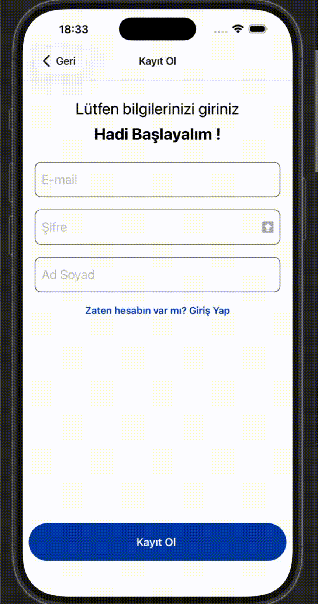

# 📱 Pokédex

**React Native** ve **TypeScript** ile yazılmış bir Pokédex mobil uygulaması. Pokémon'ları tür renkleri ve tür ikonlarıyla listeler, bölgeleri gösterir. Kullanıcılar kayıt olup giriş yapabilir ve kendi favori Pokémon listelerini oluşturabilir.


---

## 📸 Ekran Görüntüleri



## ✨ Özellikler

- **Onboarding:** Uygulama ilk açıldığında 3 adımlı tanıtım ekranları ("Atla" butonuyla geçilebilir)
- **Pokémon listesi:** Pokémon'lar numara, isim, görsel ve tür bilgileriyle listelenir. Kartlar türe göre renklenir, SVG tür ikonları gösterilir
- **Bölgeler:** Kanto, Johto, Hoenn, Sinnoh, Unova, Kalos... bölgeleri nesil bilgisi ve başlangıç Pokémon'larıyla birlikte listelenir
- **Kimlik doğrulama:** Kayıt ol, giriş yap ve şifremi unuttum ekranları (e-mail formatı ve şifre uzunluğu kontrolü yapılır)
- **Favoriler:** Giriş yapan her kullanıcının kendine ait favori listesi vardır. Kalp ikonuna basarak Pokémon ekleyip çıkarabilirsin
- **Profil:** Giriş yapan kullanıcının bilgileri gösterilir, çıkış yapılabilir
- **Alt sekme menüsü:** Pokémonlar, Bölgeler, Favoriler ve Hesabım sekmeleri; her sekmenin aktif/pasif ikonu var

## 🛠️ Kullanılan Teknolojiler

| Alan | Teknoloji |
| --- | --- |
| Framework | React Native 0.86 (React 19) |
| Dil | TypeScript |
| State yönetimi | Redux Toolkit + React Redux |
| Navigasyon | React Navigation (Native Stack + Bottom Tabs) |
| İkonlar | iconsax-react-nativejs, react-native-svg |
| Test / Kod kalitesi | Jest, ESLint, Prettier |

## 📂 Proje Yapısı

```
pokedex/
├── App.tsx                  # Redux Provider + NavigationContainer
├── index.js                 # Uygulamanın giriş noktası
├── android/                 # Android native projesi
├── ios/                     # iOS native projesi
└── src/
    ├── assets/              # Pokémon görselleri ve sekme ikonları
    ├── components/
    │   ├── navigaton/       # Sekme menüsü ikonları
    │   ├── pokedex/         # Pokémon kartı (PokedexItem)
    │   ├── regions/         # Bölge kartı (RegionCard)
    │   └── ui/              # Button, Input, Swipe gibi ortak bileşenler
    ├── models/              # TypeScript tipleri (data + ui props)
    ├── navigaiton/          # Root stack ve tab navigator
    ├── redux/
    │   ├── slices/          # authSlice, favoritesSlice
    │   ├── hooks.ts         # Tipli useAppDispatch / useAppSelector
    │   └── store.ts         # Redux store
    ├── screens/
    │   ├── auth/            # Giriş, Kayıt, Şifremi Unuttum
    │   ├── onBoarding/      # Tanıtım ekranları
    │   ├── pokedex/         # Pokémon listesi
    │   ├── regions/         # Bölgeler
    │   ├── favorites/       # Favoriler
    │   └── profile/         # Hesabım
    ├── store/               # Statik veriler (Pokémon listesi, bölgeler, tür ikonları, görsel eşleştirmeleri)
    ├── styles/              # Ortak stiller
    ├── theme/               # Renk paleti (Pokémon tür renkleri)
    └── utils/               # Route isimleri
```

## 🚀 Kurulum ve Çalıştırma

### Gereksinimler

- [Node.js](https://nodejs.org/) **>= 22.11.0**
- React Native ortam kurulumu: [Set Up Your Environment](https://reactnative.dev/docs/set-up-your-environment)
- iOS için: Xcode, Ruby ve CocoaPods (sadece macOS)
- Android için: Android Studio ve Android SDK

### 1. Projeyi klonla

```sh
git clone https://github.com/<kullanici-adin>/pokedex.git
cd pokedex
```

### 2. Bağımlılıkları yükle

```sh
npm install
```

### 3. iOS bağımlılıklarını yükle (sadece iOS için)

```sh
bundle install
cd ios && bundle exec pod install && cd ..
```

### 4. Metro'yu başlat

```sh
npm start
```

### 5. Uygulamayı çalıştır

Yeni bir terminal açıp:

```sh
# iOS
npm run ios

# Android
npm run android
```

## 📜 Script'ler

| Komut | Açıklama |
| --- | --- |
| `npm start` | Metro bundler'ı başlatır |
| `npm run ios` | Uygulamayı iOS simülatöründe çalıştırır |
| `npm run android` | Uygulamayı Android emülatöründe/cihazda çalıştırır |
| `npm run lint` | ESLint ile kodu kontrol eder |
| `npm test` | Jest testlerini çalıştırır |

## 📝 Notlar

- Pokémon ve bölge verileri statiktir, `src/store/` altındaki dosyalardan gelir; herhangi bir API kullanılmaz.
- Kullanıcı ve favori bilgileri sadece Redux store'da (bellekte) tutulur. Uygulama kapatılınca bu bilgiler silinir.
- Pokémon tür ikonları [duiker101/pokemon-type-svg-icons](https://github.com/duiker101/pokemon-type-svg-icons) reposundan alınmıştır.


## ⚖️ Yasal Uyarı

Bu proje eğitim amaçlı yapılmıştır. Pokémon ve Pokémon karakter isimleri Nintendo, Game Freak ve The Pokémon Company'nin ticari markalarıdır.
